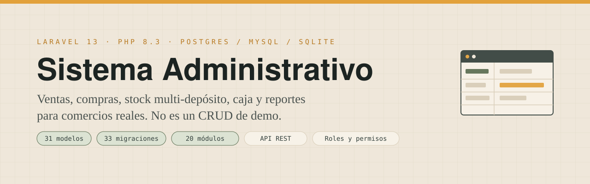
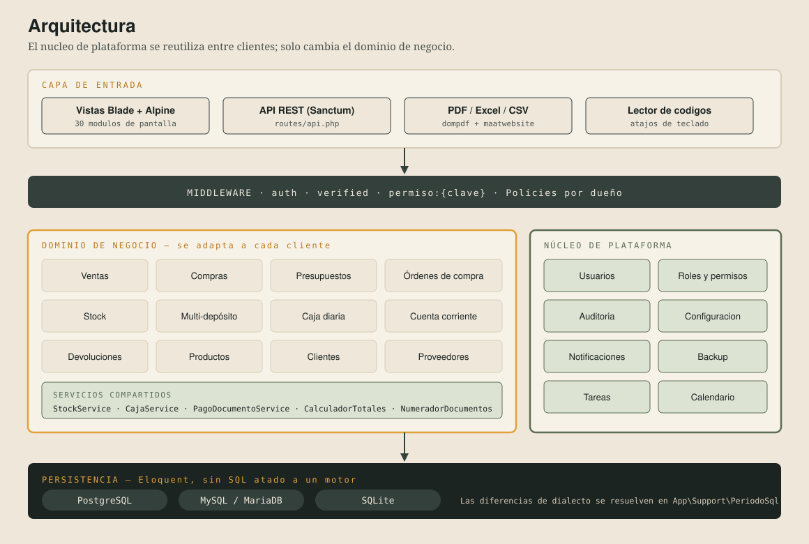
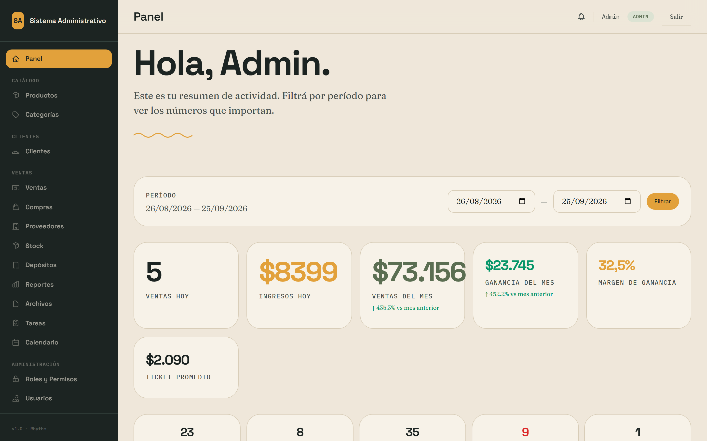
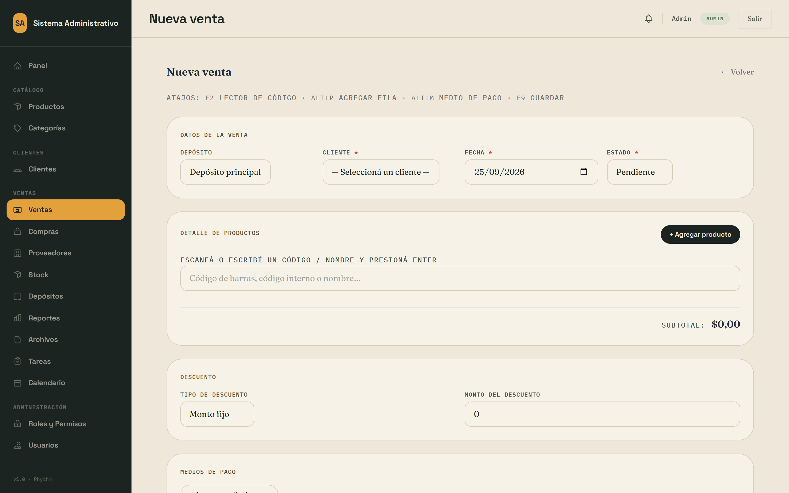
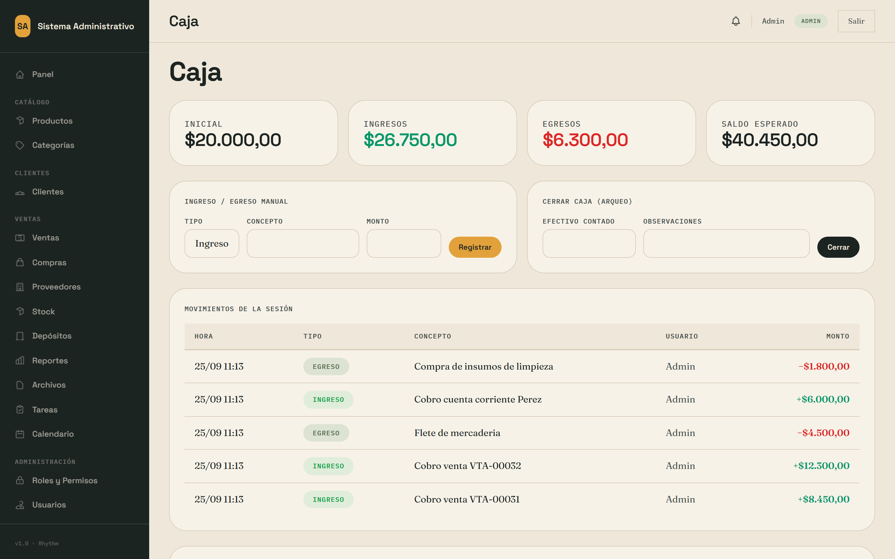
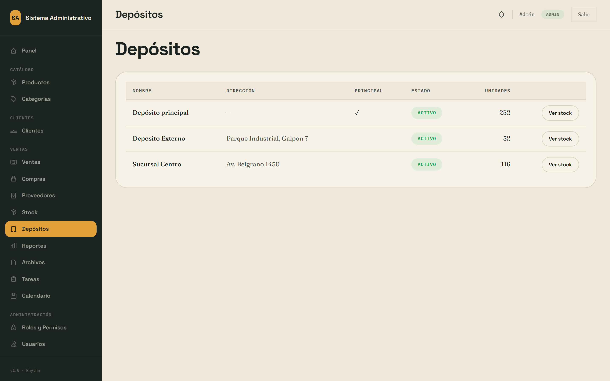
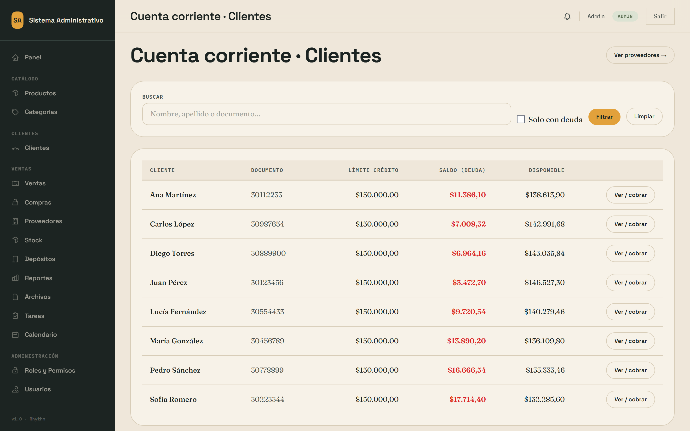
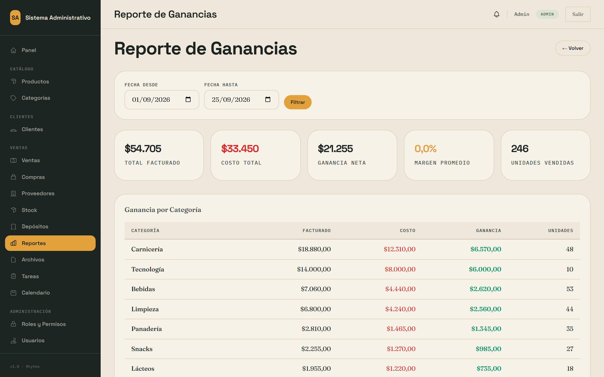
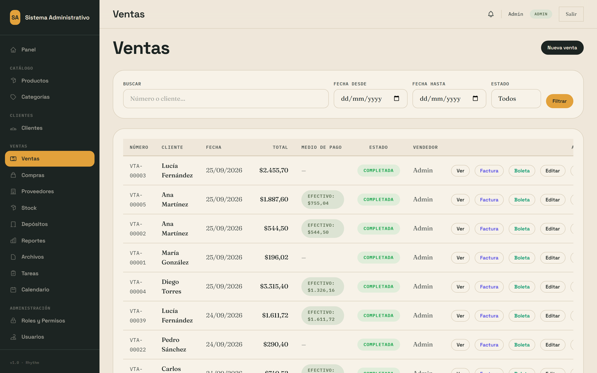
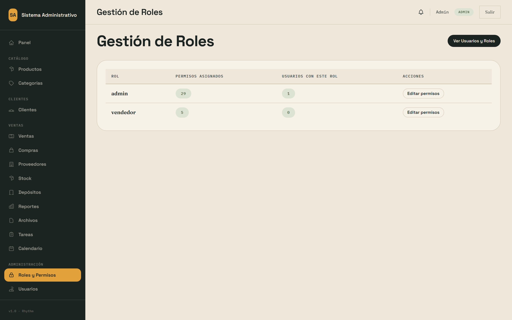

<p align="center">
  
</p>

<p align="center">
  <a href="https://github.com/joaquinyunes/CRUD/actions/workflows/ci.yml"></a>
  
  
  
  
  
</p>

# Sistema Administrativo

Sistema de gestión para comercios: **vender, comprar, controlar stock en varios depósitos, cerrar la
caja del día, llevar la cuenta corriente de clientes y proveedores, y sacar reportes de rentabilidad.**

No es un CRUD de ejemplo. Es un sistema con reglas de negocio reales: el stock no se puede sobrevender,
los comprobantes se numeran de forma consecutiva y sin huecos, una venta anulada devuelve el stock sin
borrar el historial, una orden de compra se puede recibir parcialmente, y cada movimiento queda
auditado con el usuario que lo hizo.

Está pensado para adaptarse a distintos rubros —ferretería, kiosco, distribuidora, taller, local de
ropa— cambiando el dominio de negocio y reutilizando el núcleo de usuarios, roles, permisos y auditoría.

---

## Demo

**URL:** **https://crud-erp.onrender.com**

Tres cuentas, para ver el sistema desde los tres lados:

| Cuenta | Contraseña | Rol | Qué puede hacer |
|---|---|---|---|
| `admin@admin.com` | `password` | admin | Todo: usuarios, roles, auditoría, backup, configuración. |
| `vendedor@demo.com` | `vendedor1234` | Vendedor | Opera el día a día: ventas, presupuestos, clientes, compras, stock, caja. No entra a administración. |
| `lectura@demo.com` | `lectura1234` | Solo Lectura | Ve todos los listados y reportes y puede exportar, pero no crea, edita ni borra nada: los botones ni aparecen y las rutas de escritura devuelven 403. |

La demo se carga con `DemoSeeder`: categorías, productos con stock real, clientes, proveedores, ventas,
compras, caja abierta con movimientos del día y cuenta corriente con saldos, para que se vea
funcionando desde el primer minuto.

> Corre en el plan gratuito de Render: la primera visita después de un rato de inactividad tarda
> entre 30 y 60 segundos en levantar el contenedor.

---

## Qué resuelve

### Ventas
Venta con varias líneas, descuento por monto o porcentaje, impuesto configurable, varios métodos de
pago en la misma operación y venta a cuenta corriente. Búsqueda de productos por código de barras con
atajos de teclado para operar sin mouse.

### Compras y proveedores
Compras con recepción de mercadería, y órdenes de compra con **recepción parcial**: se recibe lo que
llegó y la orden queda abierta por el resto, con facturación posterior.

### Stock multi-depósito
Stock por depósito, transferencias entre depósitos y trazabilidad completa: cada entrada, salida,
ajuste y devolución queda registrada como un movimiento con su documento de origen.

### Caja diaria
Apertura de caja, movimientos de ingreso y egreso, y arqueo de cierre con la diferencia entre lo
declarado y lo esperado.

### Cuenta corriente
Saldo de clientes y proveedores, imputación de pagos a comprobantes concretos y estado de cuenta
exportable.

### Devoluciones y notas de crédito
Devoluciones de venta y de compra que reingresan o descuentan stock según corresponda, sin romper el
historial del comprobante original.

### Presupuestos
Presupuesto con fecha de vencimiento y **conversión a venta** en un click, respetando los precios
acordados.

### Reportes
Ventas y compras por día, semana y mes; productos más vendidos; mejores clientes; ranking de
proveedores; stock crítico; y rentabilidad con margen por producto y por categoría.

### Núcleo de plataforma
Roles y permisos por módulo, auditoría de cambios, configuración del negocio, notificaciones, tareas,
calendario, backup e importación/exportación en Excel y CSV.

**Doble factor de autenticación** por aplicación (TOTP): cada usuario lo activa desde su perfil
escaneando un QR con Google Authenticator, Authy, 1Password o la que use. Con el doble factor
activo, saber la contraseña no alcanza para entrar. Ocho códigos de recuperación de un solo uso para
cuando no está el teléfono.

Todo el sistema se puede operar también por **API REST** (Sanctum), no sólo por la interfaz web. Los
comprobantes se emiten en **PDF** y los listados se exportan a **Excel** y **CSV**.

---

## Arquitectura

<p align="center">
  
</p>

### Decisiones técnicas que vale la pena mirar

| Decisión | Por qué | Dónde |
|---|---|---|
| **Un solo punto de cálculo de totales** | La fórmula de subtotal, descuento, base imponible e impuesto estaba duplicada en ventas y compras y se desincronizaba. Ahora hay una sola implementación, con tests. | `app/Support/CalculadorTotales.php` |
| **Numeración de comprobantes centralizada** | Un único lugar decide el número. El consecutivo sale de bloquear la fila del contador de la serie, no de buscar el máximo en la tabla: un `SELECT ... FOR UPDATE` que no devuelve filas no bloquea nada, y con la tabla vacía dos ventas simultáneas se llevaban el mismo número. Si la transacción se revierte, el contador vuelve con ella y la serie no deja huecos. | `app/Support/NumeradorDocumentos.php` |
| **El stock se mueve en servicios, no en controllers** | Toda alta, baja o ajuste pasa por el servicio de stock, que valida disponibilidad y deja el movimiento auditado. Ningún controller toca `productos.stock` a mano. | `app/Services/StockService.php` |
| **Anular en vez de borrar** | Una venta anulada conserva el comprobante y revierte el stock. Nunca se pierde el historial. | `VentaController@anular` |
| **SQL independiente del motor** | Los reportes agrupaban con `YEARWEEK()` y `DATE_FORMAT()`, exclusivas de MySQL. El dialecto se resuelve en un solo lugar y el CI corre los tests contra los tres motores. | `app/Support/PeriodoSql.php` |
| **Permisos por clave, no roles hardcodeados** | El middleware pide `permiso:ventas.crear`. Ni siquiera "poder todo" es un nombre de rol: es el permiso comodín `*`. Un rol nuevo llamado "Dueño" con ese permiso manda igual que "Administrador", y a "Administrador" se le puede sacar una parte sin tocar código. | `app/Http/Middleware/CheckPermission.php` |
| **La API exige los mismos permisos que la web** | Un token pertenece a un usuario, y ese usuario tiene un rol: el token de un usuario de solo lectura recibe 403 al intentar escribir, igual que el botón que no le aparece en pantalla. | `routes/api.php` |
| **Un solo lugar emite un comprobante** | La API tenía su propia copia de "crear una venta", y había divergido: numeraba con `MAX(id) + 1` e ignoraba el descuento y los medios de pago. Las dos puertas llaman al mismo servicio, así que una venta cargada por pantalla y otra por API salen de la misma serie y con las mismas reglas. | `app/Services/VentaService.php` |
| **Los totales se calculan en centavos enteros** | Con float, los importes de dos decimales no tienen representación exacta y el error se acumula: cien líneas de 0,07 no daban 7,00. En un comprobante eso es que el total impreso no coincide con la suma de los renglones. | `app/Support/CalculadorTotales.php` |
| **Los formularios no embeben el catálogo** | Traían la lista completa de productos y clientes dentro del HTML, una vez por cada fila. Medido con 5.000 productos: el formulario de venta pesaba 2 MB y ahora pesa 35 KB. | `public/js/buscador.js` |
| **Nada con historial se borra: se archiva** | Un proveedor con compras o un usuario con ventas no se pueden borrar sin perder los comprobantes. En vez de dejar que reviente la clave foránea, el sistema los archiva o los desactiva y lo explica. | `ProveedorController@destroy`, `UserController@destroy` |
| **Auditoría en todos los módulos** | Ventas, compras, caja, devoluciones, presupuestos, usuarios, roles y configuración registran quién cambió qué y desde dónde, con el valor anterior y el nuevo. Nunca se guardan hashes de contraseña ni tokens. | `app/Traits/Auditable.php` |
| **Rutas separadas por módulo** | 30 archivos de rutas en lugar de un `web.php` de 800 líneas. | `routes/` |

---

## Capturas

| Panel de control | Nueva venta |
|---|---|
|  |  |
| Métricas del mes, margen real y gráficos | Carga por código de barras y totales en vivo |

| Caja diaria | Stock multi-depósito |
|---|---|
|  |  |
| Apertura, movimientos y arqueo de cierre | Unidades por depósito y transferencias |

| Cuenta corriente | Rentabilidad |
|---|---|
|  |  |
| Saldos de clientes e imputación de pagos | Margen por producto y por categoría |

| Listado de ventas | Roles y permisos |
|---|---|
|  |  |
| Filtros, estados de pago y anulación | Permisos por módulo, sin roles hardcodeados |

Las capturas se regeneran solas contra una instancia local con datos de demo:

```bash
npm install playwright && npx playwright install chromium
node docs/capturas.cjs
```

---

## Instalación

### Opción 1 — Local en 2 minutos (SQLite, sin servidor de base de datos)

```bash
git clone https://github.com/joaquinyunes/CRUD.git
cd CRUD
composer install
cp .env.example .env
php artisan key:generate
touch database/database.sqlite
php artisan migrate --seed
php artisan db:seed --class=DemoSeeder
npm install && npm run build
php artisan serve
```

Entrar a http://localhost:8000 con `admin@admin.com` / `password`.

### Opción 2 — Docker (PostgreSQL incluido, sin instalar PHP)

```bash
docker compose run --rm app php artisan key:generate --show
```

Copiar el valor —con el prefijo `base64:`— a un archivo `.env` como `APP_KEY=...` y levantar:

```bash
docker compose up --build
```

Queda en http://localhost:8080 con los datos de demo ya cargados.

### Opción 3 — MySQL / MariaDB

Descomentar el bloque de MySQL en `.env` y correr `php artisan migrate --seed`.

---

## Deploy en Render

El repositorio trae un [blueprint de Render](render.yaml) que crea el servicio web y la base
PostgreSQL ya enlazados entre sí.

1. **Render → New → Blueprint** y conectar este repositorio.
2. Render detecta `render.yaml` y propone el web service más la base Postgres.
3. Cargar la única variable que Render no puede generar:

   ```bash
   php artisan key:generate --show
   ```

   Pegar el resultado completo en la variable de entorno `APP_KEY`.
4. Deploy. El primer arranque corre las migraciones y, con `DB_SEED_ON_BOOT=true`, carga los datos de
   demostración.

Para la instalación real de un cliente, poner `DB_SEED_ON_BOOT=false`.

### De la demo a una instalación real

La demo corre en el plan gratuito de Render con todo adentro de un contenedor. Para una instalación
que va a facturar de verdad, tres cosas cambian:

| Qué | En la demo | En producción |
|---|---|---|
| **Datos de demostración** | `DB_SEED_ON_BOOT=true` | `false`. El comando `demo:sembrar` sólo siembra si la base está vacía y, si no puede verificarlo, no toca nada: es preferible arrancar sin datos que pisar los de un cliente. |
| **Archivos subidos** (adjuntos, PDFs, backups) | disco del contenedor, que se borra en cada deploy | `FILESYSTEM_DISK=s3` con las credenciales de cualquier S3 (AWS, Cloudflare R2, Backblaze B2, MinIO). El driver ya viene instalado. |
| **Cola y tareas programadas** | dentro del contenedor web (`RUN_WORKERS=true`) | servicio de fondo aparte —el bloque `worker` comentado en [`render.yaml`](render.yaml)— y `RUN_WORKERS=false`, para que reiniciar el web no corte un job a la mitad. |

Lo que corre solo, una vez configurado el programador: los presupuestos vencen al pasar su validez,
sale un aviso diario de stock crítico, y se purgan los tokens de API vencidos y los jobs fallidos
viejos. Está todo en [`routes/console.php`](routes/console.php).

> **Sobre Vercel:** no es el lugar para este sistema. Vercel es serverless: no hay proceso
> persistente, ni sistema de archivos escribible para `storage/`, ni base de datos relacional propia.
> Las sesiones, los PDFs generados, los archivos adjuntos y las colas dejarían de funcionar. Render
> —o cualquier VPS con Docker— es la opción correcta.

---

## Tests

```bash
php artisan test
```

**165 tests.** Cubren las reglas que importan, no getters y setters:

**Negocio**
- el stock se descuenta al confirmar una venta y se repone al anularla;
- no se puede vender más stock del disponible, ni siquiera cuando el total alcanza pero el depósito no;
- los totales con descuento e impuesto dan lo que tienen que dar, y un descuento mayor al 100% se rechaza;
- la numeración es consecutiva, no se repite, no deja huecos cuando una transacción se revierte, y arranca donde estaba si la base venía de una versión anterior;
- anular una venta no libera su número;
- la caja cierra con la diferencia correcta;
- la cuenta corriente imputa cada pago al comprobante correcto;
- una orden de compra recibida parcialmente queda abierta por el resto;
- los reportes por período funcionan en SQLite, MySQL y PostgreSQL;
- el total cierra contra la suma de sus partes al centavo, con descuentos en porcentaje y decimales.

**Permisos y seguridad**
- un vendedor no puede ver ni editar las ventas de otro;
- un rol inventado con el permiso comodín puede todo, y uno llamado "Administrador" sin permisos no puede nada;
- cambiar los permisos de un rol se aplica en el acto, no cuando expira la caché;
- la API devuelve 401 sin token y 403 cuando el token es de alguien que no tiene ese permiso;
- el login de API se bloquea a los 5 intentos fallidos;
- un usuario desactivado no entra, y si tenía la sesión abierta lo echa en el próximo request;
- con doble factor activo, la contraseña correcta no abre sesión: queda esperando el código;
- un código de recuperación entra una sola vez y después deja de servir;
- el secreto del doble factor no queda en claro en la base.

**Integridad de datos**
- borrar un proveedor con compras lo archiva en vez de romper; sin compras, sí lo borra;
- borrar un usuario con ventas lo desactiva y conserva sus comprobantes;
- crear, cambiar y anular queda en la auditoría con su autor, el antes y el después;
- la auditoría nunca guarda el hash de la contraseña;
- un cambio hecho sin sesión (consola, cola, tarea programada) también queda registrado;
- el valor por defecto de una configuración no se cachea pisando al de otra llamada;
- una venta cargada por API y otra por pantalla comparten la misma serie de números;
- la API aplica el límite de crédito y el control de stock, igual que la interfaz;
- las pantallas que usan el layout como componente muestran su contenido (un 200 en blanco no delata nada).

El CI corre, en cada push: la suite contra los **tres motores de base de datos**, las **migraciones de punta a punta contra una base limpia** en los tres, **PHPStan nivel 5**, el estilo con **Pint**, y `composer audit` + `npm audit` para no arrastrar dependencias con vulnerabilidades conocidas.

```bash
vendor/bin/phpstan analyse   # análisis estático, nivel 5, sin errores
vendor/bin/pint --test       # estilo
composer audit               # dependencias
```

---

## API REST

Autenticación con Laravel Sanctum. Los módulos de negocio exponen los mismos casos de uso que la
interfaz web, con la misma validación de stock, la misma numeración de comprobantes y **los mismos
permisos**: un token pertenece a un usuario, y ese usuario tiene un rol. El token de la cuenta de
solo lectura de la demo lista productos y recibe `403` al intentar crearlos, exactamente igual que en
pantalla.

El login está limitado a 5 intentos por minuto y el resto de la API a 60 pedidos por minuto y por
usuario.

```bash
curl -X POST https://tu-dominio/api/ventas \
  -H "Authorization: Bearer $TOKEN" \
  -H "Content-Type: application/json" \
  -d '{
        "cliente_id": 1,
        "fecha": "2026-09-24",
        "detalles": [{"producto_id": 5, "cantidad": 2, "precio": 180}]
      }'
```

Ver [`routes/api.php`](routes/api.php).

---

## Estructura

```
app/
  Console/Commands/     tareas programadas y el sembrado seguro de la demo
  Http/Controllers/     48 controllers web + API, finos: traducen el pedido y poco más
  Http/Requests/        29 FormRequests; los documentos con líneas comparten reglas
  Http/Middleware/      CheckPermission (permisos por clave), EnsureUserIsActive
  Models/               31 modelos Eloquent
  Services/             VentaService, CompraService, StockService, CajaService,
                        PagoDocumentoService, DobleFactorService
  Support/              CalculadorTotales, NumeradorDocumentos, PeriodoSql, Orden
  Policies/             autorización por dueño del comprobante
  Traits/Auditable      registro automático de cambios, en todos los módulos
database/
  migrations/           39 migraciones
  seeders/DemoSeeder    datos de demostración realistas
routes/                 32 archivos, uno por módulo
resources/views/        Blade + Alpine, design system propio (public/css/rhythm.css)
public/js/buscador.js   autocompletado de los formularios de carga
tests/                  165 tests: negocio, permisos, integridad de datos y seguridad
phpstan.neon            análisis estático nivel 5
docker/ Dockerfile render.yaml docker-compose.yml
```

---

## Stack

- **Backend:** Laravel 13 · PHP 8.3 · Eloquent · Sanctum
- **Frontend:** Blade · Alpine.js · Tailwind · design system propio
- **Base de datos:** PostgreSQL, MySQL/MariaDB o SQLite
- **Documentos:** dompdf (PDF) · maatwebsite/excel (Excel, CSV)
- **Infraestructura:** Docker (FrankenPHP) · Render · GitHub Actions

---

## Licencia y uso comercial

Este proyecto es **source available**, no open source: se puede leer, clonar y evaluar libremente,
pero usarlo para operar un negocio requiere una licencia comercial. Ver [LICENSE](LICENSE).

**¿Necesitás este sistema para tu comercio?** Se entrega instalado, con los módulos adaptados a tu
rubro, migración de los datos que ya tenés y capacitación. Contacto:
[github.com/joaquinyunes](https://github.com/joaquinyunes).
